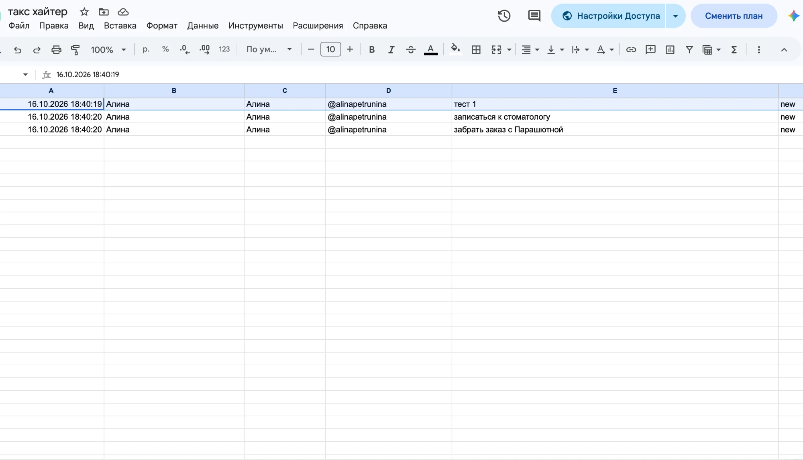

University: [ITMO University](https://itmo.ru/ru/)
Faculty: [FICT](https://fict.itmo.ru)
Course: [Vibe Coding: AI-боты для бизнеса](https://github.com/itmo-ict-faculty/vibe-coding-for-business)
Year: 2026/2027
Group: U4125
Author: Arlanova Alina Andreevna
Lab: Lab3
Date of create: 16.10.2026
Date of finished: 

# Лабораторная работа 3. Запуск бота для реального использования

**Бот:** [@task_hunter_bot](https://t.me/task_hunter_bot)

**Код:**
- рабочая версия на Google Apps Script — [`lab1/apps-script/Code.gs`](../lab1/apps-script/Code.gs);
- версия на Python, подготовленная к запуску через ngrok, — [`lab3/bot`](bot/).

## 1. Описание деплоя

### Какой способ выбран

**Облачный запуск в Google Apps Script по триггеру по времени.** Это вариант 2 из задания («облачный хостинг»), только вместо Railway или Render используется облако Google.

```
Коллеги и я ──► Telegram (общий чат / личка)
                    ▲
                    │ getUpdates, раз в минуту
                    │
        Google Apps Script: триггер по времени → pollTelegram()
                    │
                    ▼
            Google Таблица (задачи и их статусы)
```

### Почему именно этот

- **Работает круглосуточно без моего компьютера.** Триггер запускает скрипт на серверах Google, ноутбук можно выключить.
- **Бесплатно и без привязки карты.** Railway и Fly.io требуют карту или ограничивают бесплатный тариф; Apps Script входит в обычный Google-аккаунт.
- **Нет отдельного сервера и базы.** Данные сразу лежат в таблице, к которой есть доступ у коллег.
- **Перезапуск и обновление — в браузере.** Поменять код: открыть редактор Apps Script → сохранить. Следующий запуск триггера уже идёт с новым кодом.

### URL бота

[@task_hunter_bot](https://t.me/task_hunter_bot)

## 2. Процесс деплоя

### Пошаговая инструкция

1. Создать бота у [@BotFather](https://t.me/BotFather) (`/newbot`) и получить токен.
2. Создать Google Таблицу, открыть **Расширения → Apps Script**.
3. Вставить код из [`Code.gs`](../lab1/apps-script/Code.gs), указать токен в `TELEGRAM_TOKEN` и ID таблицы из её ссылки в `SPREADSHEET_ID`. Сохранить.
4. Один раз запустить `pollTelegram` вручную (кнопка «Выполнить») и выдать скрипту разрешения на доступ к таблице и внешним запросам.
5. Слева **Триггеры** (значок будильника) → **Добавить триггер** → функция `pollTelegram`, источник «По времени», «Таймер по минутам», «Каждую минуту» → Сохранить.
6. Добавить бота в общий рабочий чат и проверить: отправить `/task@task_hunter_bot тестовая задача` и примерно через минуту увидеть строку в таблице.

### С какими проблемами столкнулись и как решили

| Проблема | Решение |
|---|---|
| Apps Script не может держать постоянное соединение и принимать webhook так же просто, как обычный сервер | Используется короткий опрос `getUpdates` по триггеру раз в минуту |
| При каждом запуске Telegram отдаёт уже обработанные сообщения, задачи задваивались бы | Номер последнего `update_id` хранится в `PropertiesService`, следующий запрос идёт с `offset` |
| В группе команда приходит с именем бота: `/task@task_hunter_bot` | Регулярное выражение учитывает `@имя_бота` и пробел после `/` |
| Если очередь сообщений «застряла» | Функция `resetTelegramOffset` сбрасывает сохранённый номер |
| У одного токена может быть только один получатель обновлений: нельзя одновременно запустить Apps Script и версию на Python | В работе оставлена версия на Apps Script, версия на Python запускается только с отдельным токеном |

### Стабильность

Бот работает с лета 2026 без перезапусков и обслуживания. Триггер выполняется каждую минуту; новые задачи появляются в таблице с задержкой не больше минуты (на скриншоте ниже сообщения отправлены в 18:39, строки записаны в 18:40). История запусков и ошибки видны в редакторе Apps Script в разделе **Выполнения**.

## 3. Сбор фидбека

### Количество пользователей

Бот добавлен в общий рабочий чат, им пользуются **3 коллеги** и я. Коллеги ставят задачи прямо из чата командой `/task@task_hunter_bot`, я — в личке с ботом.

### Статистика использования

По Google Таблице (тексты задач не публикуются, в них рабочая информация):

| Показатель | Значение |
|---|---|
| Пользователей бота | 4 (3 коллеги + я) |
| Срок использования | с лета 2026 |
| Задач в таблице | 9 |
| Закрыто | 7 (78%) |
| В работе | 2 |
| Из личного чата с ботом | 8 |
| Из общего рабочего чата | 1 |



### Отзывы

| Вопрос из задания | Ответ коллег |
|---|---|
| Что понравилось? | удобно: задачу можно поставить, не выходя из рабочего чата |
| Что не понравилось? | замечаний не было |
| Что можно улучшить? | пожеланий не было |
| Хотели бы использовать? | да, пользуются с лета |

## 4. Анализ фидбека

**Что понравилось пользователям.** Бот не требует ничего, кроме одной команды в привычном чате: ни отдельного приложения, ни регистрации.

**Главные проблемы.** Явных жалоб не было, но по таблице и по опыту использования видны слабые места:

1. **Бот молчит.** После `/task` нет подтверждения, и непонятно, записалась ли задача, пока не откроешь таблицу.
2. **Закрывать задачи можно только в таблице.** Все 7 закрытых задач закрыты вручную.
3. **Коллеги почти не ставят задачи через бота.** Из 9 задач из общего чата только 1: возможно, из-за того, что не видно результата, или проще написать сообщение напрямую.
4. **Нет сроков.** Дедлайны («до вечера», «после июня») пишутся в тексте, и бот о них не напоминает.

**Приоритеты улучшений:**

| Улучшение | Влияние | Сложность | Приоритет |
|---|---|---|---|
| Ответ «✅ Задача записана» с номером | высокое: видно, что задача дошла | низкая | 1 |
| Закрытие задачи из чата (`/done`, кнопка) | среднее | средняя | 2 |
| Дедлайны и напоминания | среднее | высокая | 3 |

## 5. Улучшения

В рабочую версию на Apps Script изменения не вносились: коллегам удобно, и ломать работающий процесс не хотелось.

Все найденные недостатки уже закрыты в **версии на Python** ([`lab3/bot`](bot/)), она готова к запуску:

| Проблема из анализа | Как решено в версии на Python |
|---|---|
| Бот молчит | на каждую задачу — ответ с номером, приоритетом и дедлайном |
| Закрыть можно только в таблице | `/done N` и кнопка «✅ Готово», статус обновляется и в Google Таблице |
| Нет сроков | дедлайн распознаётся из текста, напоминание за час, утренний дайджест |
| Мало обратной связи | встроенный `/feedback` с оценкой ⭐1–5, отзывы сразу приходят администратору; `/admin` со статистикой использования |

Подготовка версии на Python к запуску:

| Требование из задания | Как сделано |
|---|---|
| Токен в переменных окружения | `BOT_TOKEN` и все настройки в `.env`, в git только `.env.example` |
| `.gitignore` | `.env`, `credentials.json`, `*.db`, `*.log`, `__pycache__/`, `.venv/` |
| `requirements.txt` | добавлен extra `[webhooks]` (веб-сервер tornado для приёма webhook) |
| Логирование | в консоль и в `bot.log` с ротацией 5 × 1 МБ |
| Обработка ошибок | глобальный error handler + проверка настроек при старте (`WEBHOOK_URL` должен быть `https://`) |
| Безопасность webhook | `WEBHOOK_SECRET`: Telegram присылает его в заголовке `X-Telegram-Bot-Api-Secret-Token`, запросы без него отклоняются |

Новое для работы с пользователями:

- `/feedback` — оценка ⭐1–5 кнопками, затем текст отзыва одним сообщением (или `/skip`). Оценка и текст сохраняются **одной записью** и сразу приходят администратору в Telegram.
- Статистика использования: обработчик в `group=-1` видит каждое обновление раньше остальных и пишет в таблицу `events`, какое действие сделал пользователь.
- `/admin` — пользователи всего и за 24 часа, задачи, популярные действия, средняя оценка; `/feedbacks` — последние отзывы.

Запуск — через ngrok в режиме webhook, инструкция в [`lab3/bot/README.md`](bot/README.md). Для постоянной работы есть `Dockerfile` и `docker-compose.yml`. Версия проверена 26 автотестами и прогоном всех команд на тестовых сообщениях Telegram.

### Новый фидбек

Повторный сбор отзывов планируется после перехода коллег на версию на Python.

## 6. Выводы

**Что получилось хорошо.** Бот дошёл до реального использования: работает в облаке Google с лета, им пользуются коллеги в рабочем чате, 78% записанных задач закрыто. Деплой оказался проще, чем на классическом хостинге: ни сервера, ни карты, ни включённого компьютера.

**Что можно улучшить дальше.** Добавить подтверждение записи задачи и закрытие из чата: это самое заметное ограничение рабочей версии. Перевести коллег на версию на Python или перенести её главные функции в Apps Script. Собирать отзывы регулярно, а не только устно: для этого в версии на Python есть `/feedback`.

**Чему научились.** Деплой — это не обязательно сервер: для простого бота хватает триггера в Apps Script. Отсутствие жалоб не значит отсутствие проблем — полезно смотреть на реальные данные использования (кто, откуда и как часто ставит задачи). И разница между polling и webhook: почему Apps Script опрашивает Telegram по таймеру, а версии на Python через ngrok нужен публичный HTTPS-адрес.
